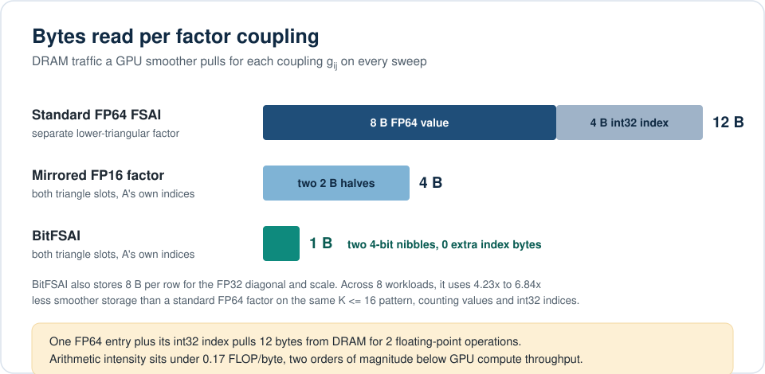
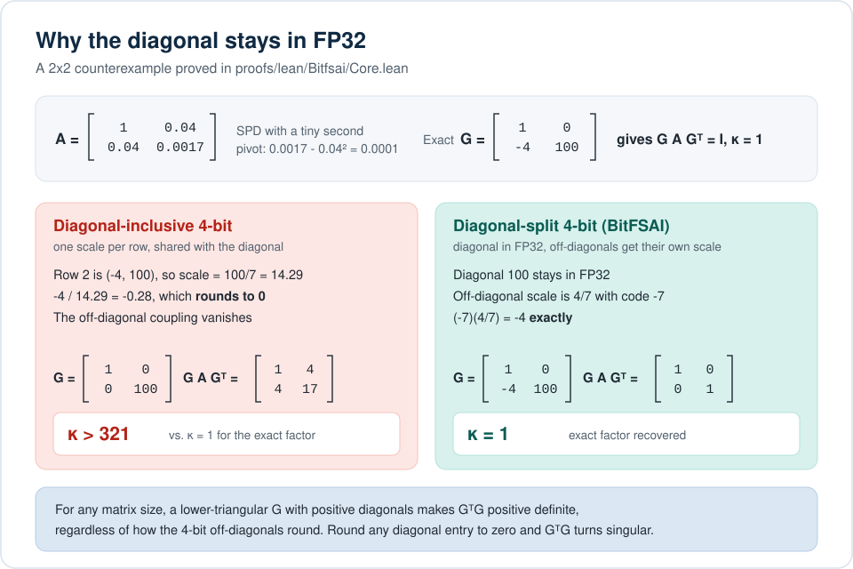
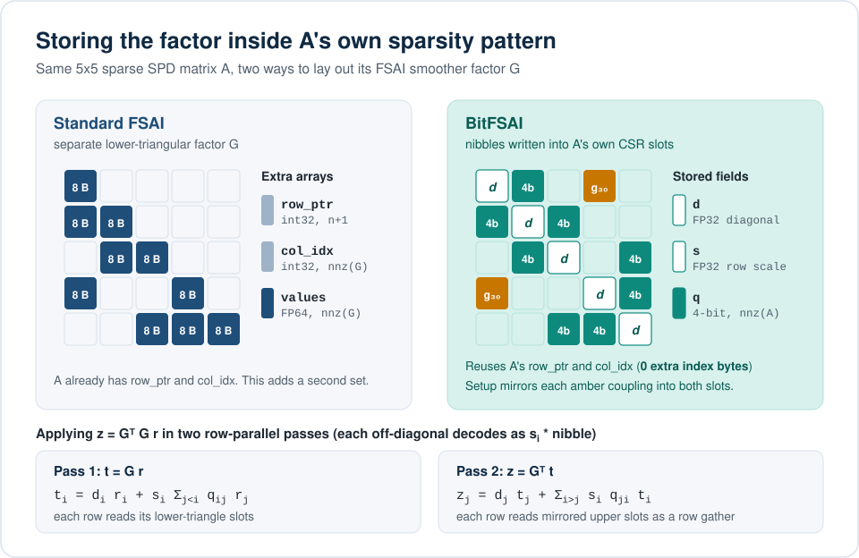
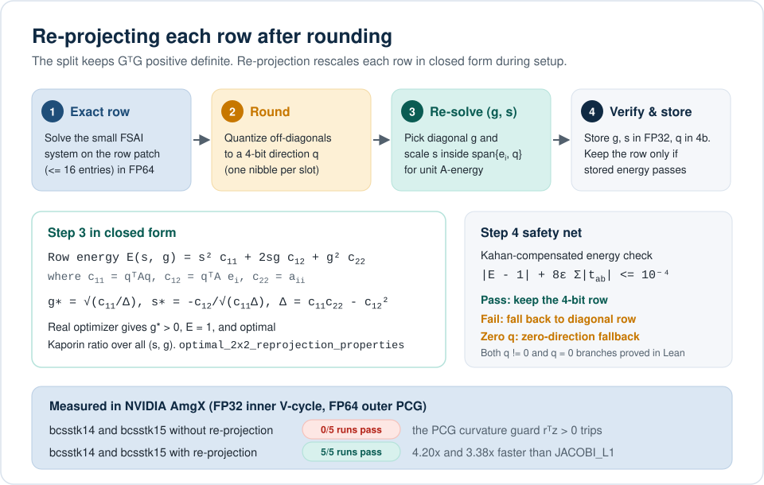
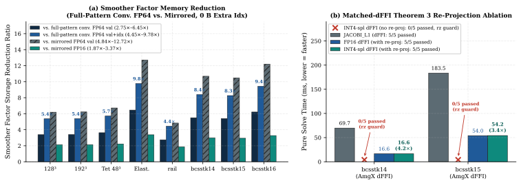
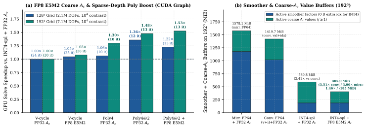

# BitFSAI

BitFSAI stores the smoother inside a double-precision GPU algebraic multigrid solver at 4 bits per weight and still hits a `10^-8` host-checked residual. Compared to a standard `FP64` factor on the same sparsity pattern, it cuts smoother storage by 4.23x to 6.84x counting values and `int32` indices, with zero extra index arrays.

[Paper (PDF)](paper/bitfsai.pdf) | [AmgX fork](https://github.com/bbopen/AMGX/tree/bitfsai-smoother) | [Lean proofs](proofs/lean/) | [Raw benchmark data](benchmarks/results/) | [MIT License](LICENSE)

## Why GPU physics solvers wait on memory

Simulating 3D heat diffusion or linear elasticity reduces to solving a sparse linear system `A x = b`. Each of the millions of unknowns couples to between 7 and 75 neighbors. Production solvers pair preconditioned conjugate gradient with algebraic multigrid.

On a GPU, reading one `FP64` entry and its `int32` column index pulls 12 bytes from DRAM for 2 floating-point operations. Arithmetic intensity sits below 0.17 FLOP/byte, two orders of magnitude below what the silicon can compute. Shrink the bytes read per coupling and the solve gets faster.



Four-bit weights broke a similar memory wall in neural networks because small rounding errors average out across wide dense layers. Double-precision scientific solvers do not forgive that. The outer PCG loop checks a true `FP64` relative residual of `10^-8` on the host, and the preconditioner has to stay symmetric positive definite on every step. Round one diagonal entry to zero or spike one local eigenvalue, and the curvature guard `r^T z > 0` trips and kills the solve.

Naive 4-bit rounding fails right away. On a 2x2 SPD matrix checked in Lean as `counterexample_2x2_kappa_gt_321`, sharing a single 4-bit scale across the diagonal and off-diagonal pushes the condition number past 321. In a 3D two-grid test, incomplete Cholesky hits a 7.3x spectral-radius cliff at 3 bits.

## How BitFSAI works

BitFSAI builds on the Factorized Sparse Approximate Inverse smoother, `z = G^T G r`. FSAI runs cleanly in parallel on GPUs, though standard versions store `FP64` weights alongside a second set of CSR index arrays.

Every row keeps its positive diagonal and row scale in `FP32` and compresses only the off-diagonals to signed 4-bit nibbles. As long as every diagonal stays positive, `G^T G` remains positive definite for any matrix size regardless of how the off-diagonals round. Pulling the diagonal out of the 4-bit scale stops small couplings from rounding away to zero.



Setup writes each 4-bit nibble into both the lower and symmetric upper slots of the matrix's existing CSR pattern. That costs 0.5 bytes per nonzero of `A` plus 8 bytes per row, and it reuses `A`'s `row_ptr` and `col_idx` arrays directly. Mirroring each coupling lets both passes of `G^T G r` run as row-parallel gathers with zero separate factor indices.



After rounding a row's off-diagonals, setup solves a closed-form 2x2 system in `FP64` for that row's diagonal and scale so the real-valued row reaches exact unit `A`-energy. Setup casts both scalars to `FP32` and runs a Kahan-compensated energy check against the CSR entries. Any row that fails the check or has all zero off-diagonals falls back to a verified diagonal row. Without this re-projection step in AmgX, pass rates on `bcsstk14` and `bcsstk15` fall from 5/5 to 0/5.



The standalone CUDA-Graph engine also compresses coarse multigrid operators to `FP8 E5M2` with row-sum diagonal repair. Before a coarse level uses `FP8`, setup checks for nonpositive off-diagonals, grounded connected components, and magnitudes inside the normal `E5M2` range `[2^-14, 57344]`. Any level that fails stays in `FP32`. Adding a two-call polynomial boost on every fourth level (`poly4@2`, scale `t = 1.25`) cuts outer PCG iterations further with zero host sync inside the captured graph.


The paper also asks how far below 4 bits these guarantees hold before compression breaks down. On a 3-vertex grounded SDDM example proved in Lean, ternary weights `{-1, 0, +1}` at 1.58 bits keep the local condition number at or below 3 while 1-bit sign-only weights `{-1, +1}` diverge. For any `r`-predecessor grounded SDDM patch, ternary truncation carries an `r + 1` local loss bound that does not depend on material contrast. The same section works out covering bounds for sub-bit shared codebooks, zero-storage operators rebuilt from physical laws, and quadratic drift bounds when a nonlinear tangent shifts across Newton steps.


The GPU code and benchmarks stop at the 4-bit smoother and guarded `FP8` coarse operators. Everything below 4 bits is theory with core theorems proved in Lean and Z3, with no GPU kernels yet.

## Results

We ran all GPU benchmarks sequentially on an NVIDIA RTX Spark N1X across 8 SPD workloads. The synthetic 3D problems cover anisotropic `10^4`-contrast grids at `128^3` with 2.10M unknowns and `192^3` with 7.08M unknowns, along with a `48^3` tetrahedral FEM diffusion mesh and `28^3` linear elasticity. The SuiteSparse problems are `rail_79841_neg`, `bcsstk14`, `bcsstk15`, and `bcsstk16`. A run passes only when an independent host `FP64` check confirms `||b - Ax|| / ||b|| <= 1e-8`.

Across all 8 workloads, BitFSAI adds zero extra CSR index bytes and cuts persistent smoother factor storage as shown below.

| Baseline compared against 4-bit BitFSAI | Values only | Values + `int32` indices |
|---|---|---|
| Conventional lower-triangular `FP64`, same `K <= 16` pattern | 2.75x to 4.45x smaller | 4.23x to 6.84x smaller |
| Full-pattern lower-triangular `FSAI(1)`, `FP64` | 2.75x to 6.45x smaller | 4.45x to 9.78x smaller |
| Mirrored `FP64` (same CSR layout as BitFSAI) | 4.84x to 12.72x smaller | n/a |
| Mirrored `FP16` (same CSR layout as BitFSAI) | 1.87x to 3.37x smaller | n/a |

<p align="center">
  
</p>

Inside NVIDIA AmgX on [`bbopen/AMGX`](https://github.com/bbopen/AMGX) branch `bitfsai-smoother`, BitFSAI runs in `dFFI` mode using an `FP32` inner V-cycle wrapped in `FP64` outer PCG on the exact same `PMIS-D2` hierarchy as every baseline smoother. It passes 8/8 workloads at host `FP64` residual `<= 7.86e-9` with zero recoveries in timed trials. Against matched `dFFI` `JACOBI_L1`, BitFSAI speeds up pure solve by 1.19x to 4.20x on 6 of 8 workloads. The remaining two are near-parity on `128^3` at 1.05x and slower on the tetrahedral mesh at 0.90x. Against matched `dFFI` `BitFSAI FP16`, it runs at 1.00x to 1.12x solve speed while using 1.87x to 3.37x less smoother memory. Compared to stock all-`FP64` AmgX `dDDI` with `JACOBI_L1`, the combined shift in cycle precision, outer PCG loop, and 4-bit smoother speeds up solve time by 1.07x to 4.38x across all 8 workloads.

Setup cost is the real trade-off here. Each numeric resetup validates CSR structure and runs a per-row Cholesky factorization with a Kahan energy check. On a single solve measured as `resetup + solve`, diagonal `JACOBI_L1` still wins on 6 of 8 workloads. BitFSAI wins single-solve paired time on the two stiffest structural matrices, `bcsstk14` at 2.65x and `bcsstk15` at 2.68x. Reuse the same operator across multiple right-hand sides and setup amortizes away, leaving the pure solve win.

On the `192^3` `10^4`-contrast grid with 7.08M unknowns, [`reference/standalone_amg.cu`](reference/standalone_amg.cu) pairs the 4-bit smoother with guarded `FP8 E5M2` coarse operators and `poly4@2` boosting.

| Configuration on `192^3` | PCG iters | GPU solve | Solve speedup | `resetup + solve` speedup |
|---|---|---|---|---|
| 4-bit smoother + `FP32` coarse grids (baseline) | 28 | 1,511.1 ms | 1.00x | 1.00x |
| `poly4@2` boost + `FP32` coarse grids | 13 | 1,022.3 ms | 1.48x | 1.36x |
| `poly4@2` boost + guarded `FP8 E5M2` coarse grids | 13 | 990.4 ms | 1.53x | 1.03x (parity) |

Guarded `FP8 E5M2` shrinks coarse apply buffers by 1.86x, from 400.6 MiB down to 215.8 MiB. Combined smoother and coarse-operator storage drops 3.51x against a conventional `FP64` factor with indices and `FP32` coarse grids, and 1.46x against the 4-bit smoother with `FP32` coarse grids, saving 184.82 MiB. Paired `resetup + solve` with `FP8` sits at 1.03x parity because `build_fp8_coarse` copies coarse levels back to the host to verify connected-component grounding on every resetup. Until that check runs on the GPU, `poly4@2 + FP32` is the faster single-solve choice.

<p align="center">
  
</p>

[`paper/bitfsai.pdf`](paper/bitfsai.pdf) has the full four-engine comparison against LLNL `hypre` and Ginkgo, along with per-engine timing rules and `[min-max]` trial ranges.

## Verification

Four independent tools check the algebraic, bit-level, and runtime claims behind BitFSAI.

| Suite | Scope | Result |
|---|---|---|
| Lean 4 + Mathlib | Gram positivity under 4-bit quantization, diagonal splitting, both branches of 2x2 re-projection, Galerkin V-cycle sandwich, single-level monotone effectiveness, arbitrary-depth scalar recurrence bounds (`kappa <= 17` and `kappa <= 9`), 1-bit vs. ternary separation, and local frozen-word drift | 65 theorems, 0 `sorry`, standard axioms only (`Core` 21, `Multilevel` 28, `BitLimits` 16) |
| Z3 SMT | Exact-real core, multilevel, and bit-limit bounds, plus exhaustive `BitVec` proofs of `INT4`, `FP4 E2M1`, and `FP8 E5M2` encodings | 142 UNSAT obligations + 10 SAT negative controls (`~0.43 s`) |
| Exact-rational SymPy | Written multilevel derivations audited on concrete hierarchies | 14 grounded SDDM roots + 2 pruned hierarchies (51 levels), 63 normalized solves |
| NVIDIA `compute-sanitizer` | `memcheck`, `racecheck`, `initcheck`, `synccheck` on `test_bitfsai` and `standalone_amg --self-test` | 4/4 tools, 0 errors, 0 hazards |

The multilevel convergence bounds apply to the certified grounded SDDM hierarchy constructed in the paper, and production coarseners like `PMIS-D2` in AmgX do not carry those certificates. Section 6.6 of the paper separates what Lean and Z3 mechanize from the SymPy audits and the compiler/hardware TCB.

## Repository layout

| Path | Contents |
|---|---|
| [`paper/`](paper/) | Compiled [`bitfsai.pdf`](paper/bitfsai.pdf), Typst and LaTeX sources, bibliography, and `generate_figures.py` |
| [`reference/`](reference/) | [`bitfsai.cuh`](reference/bitfsai.cuh) drop-in CUDA smoother, [`standalone_amg.cu`](reference/standalone_amg.cu) dependency-free CUDA-Graph AMG engine, host C++17 headers, and tests |
| [`proofs/lean/`](proofs/lean/) | Lean 4 + Mathlib proofs (`Core.lean`, `Multilevel.lean`, `BitLimits.lean`) and per-theorem index |
| [`proofs/z3/`](proofs/z3/) | Four Z3 scripts covering core, multilevel, bit-encoding, and bit-limit obligations |
| [`proofs/multilevel/`](proofs/multilevel/) | `verify_sddm_cycle.py` exact-rational SDDM hierarchy audit |
| [`docs/figures/`](docs/figures/) | Six explainer SVGs used above and stdlib-only `build_explainers.py` |
| [`benchmarks/`](benchmarks/) | CPU quantization-cliff and coarse-grid sweep, [baseline drivers](benchmarks/baselines/) for AmgX, `hypre`, and Ginkgo, and [raw trial CSVs](benchmarks/results/) |

## Reproducing the checks

Install [`uv`](https://docs.astral.sh/uv/) and a Lean toolchain via [`elan`](https://github.com/leanprover/elan) pinned to `v4.37.0-rc1` to run the proof and CPU checks. Step 5 requires a CUDA toolkit with `compute-sanitizer` on an NVIDIA GPU.

```bash
# 1. Lean 4 + Mathlib proofs (65 theorems, 0 sorry, standard axioms)
(cd proofs/lean && lake exe cache get && lake build && lake env lean Bitfsai.lean)

# 2. Z3 SMT obligations (142 UNSAT + 10 SAT negative controls, ~0.43 s)
uv run --with z3-solver python3 proofs/z3/verify_bitfsai_z3.py
uv run --with z3-solver python3 proofs/z3/verify_multilevel_z3.py
uv run --with z3-solver python3 proofs/z3/verify_bit_encodings_z3.py
uv run --with z3-solver python3 proofs/z3/verify_bit_limits_z3.py

# 3. Exact-rational SDDM hierarchies (14 roots + 2 pruned) and 63 normalized solves,
#    run both normally and under -O so checks never rely on assert
uv run --with sympy python3 proofs/multilevel/verify_sddm_cycle.py
uv run --with sympy python3 -O proofs/multilevel/verify_sddm_cycle.py

# 4. Smoother quantization cliff and FP8 E5M2 coarse-grid sweep (CPU)
uv run --with numpy --with scipy python3 -m unittest discover -s benchmarks -p 'test_*.py'
uv run --with numpy --with scipy python3 benchmarks/quant_cliff_and_coarse_floor.py --export-csv benchmarks/results/cpu_precision_sweep.csv

# 5. Host C++17 checks, full CUDA test suite, and compute-sanitizer
make -C reference check-host
make -C reference check
for tool in memcheck racecheck initcheck synccheck; do
  compute-sanitizer --tool "$tool" --error-exitcode=1 ./reference/test_bitfsai
  compute-sanitizer --tool "$tool" --error-exitcode=1 ./reference/standalone_amg --self-test
done
make -C reference clean

# 6. Rebuild paper figures from benchmarks/results/*.csv and compile the PDF
uv run --with matplotlib --with numpy python3 paper/generate_figures.py
uv run --with typst python3 -c "import typst; typst.compile('paper/bitfsai.typ', output='paper/bitfsai.pdf')"
```

See [`benchmarks/baselines/README.md`](benchmarks/baselines/README.md) and [`benchmarks/results/README.md`](benchmarks/results/README.md) for SuiteSparse download steps, SHA-256 checksums, and build flags for AmgX, `hypre`, and Ginkgo.

## Citation

```bibtex
@misc{bonner2026bitfsai,
  author = {Bonner, Brett},
  title  = {BitFSAI: Extreme Bit Compression for GPU Algebraic Multigrid},
  year   = {2026},
  url    = {https://github.com/bbopen/bitfsai}
}
```

## License

[MIT](LICENSE)
